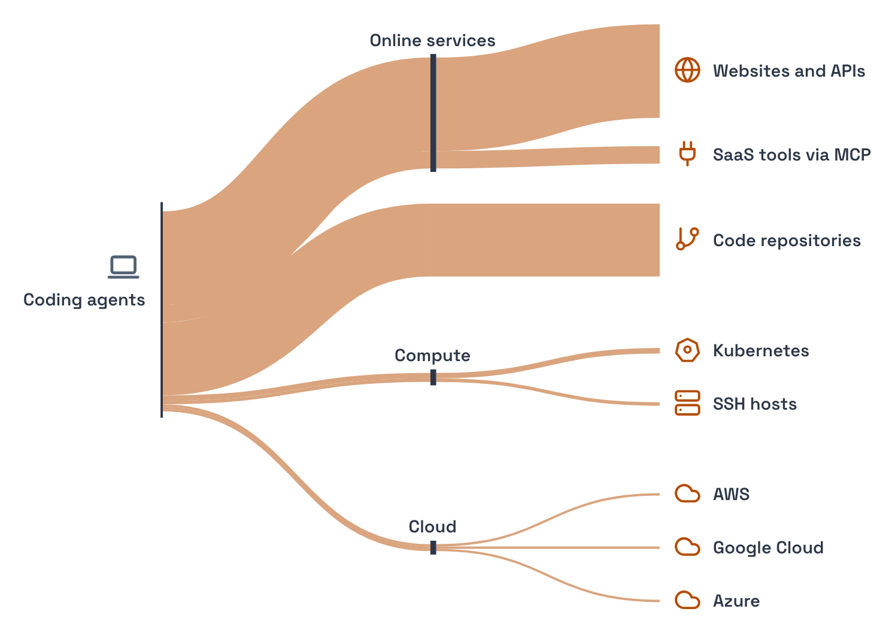

# Agent Activity

[](https://github.com/placeholdersec/agent-activity/actions/workflows/tests.yml)
[](https://github.com/placeholdersec/agent-activity/actions/workflows/security.yml)
[](LICENSE)


Agent Activity shows what coding agents did on your team's machines. It reads
the Claude Code and Codex session logs on each machine and builds a single,
self-contained HTML report of the risky commands your agents ran or attempted,
mapped to MITRE ATT&CK, and the code repositories, cloud accounts and online
systems they wrote to.



- **No dependencies.** Agent Activity is one Python file that uses only the
  standard library.
- **Runs locally.** It reads logs on the machine and writes one JSON file.
  Nothing is sent anywhere unless you provide an upload link.
- **Private by design.** Prompts, model output and code are not collected.
  Commands appear only as short examples, with secrets masked. See
  [what it reads, writes and sends](docs/privacy.md).
- **Reproducible.** The script is built from `source/`, so you can rebuild it
  and compare the result byte for byte.

## Quick start

### Prerequisites

- macOS or Linux
- Python 3.9 or later
- Claude Code logs in `~/.claude/projects`, Codex logs in `~/.codex/sessions`,
  or both

### Generate a report

Clone the repository, collect the activity on this machine, then build the
report:

```sh
git clone https://github.com/placeholdersec/agent-activity.git
cd agent-activity
python3 -I agent-activity.py
python3 -I agent-activity.py report
```

The report opens in your browser and is saved to
`agent-activity-files/agent-activity-report.html`. On a machine without a
desktop, open the file at the path the command prints.

## Report contents

1. **Risky actions** the agents ran or attempted, by MITRE ATT&CK tactic and
   severity, with the machines and sessions behind each one.
2. **Systems** the agents accessed, including repositories, cloud accounts,
   clusters, registries and online services, by kind and provider, with which
   ones they wrote to and which they only read.
3. **Other code** the agents started, such as scripts, inline code, builds and
   containers. An agent's own command policies can't inspect this code.

Findings come from detection rules derived from open-source rule sets,
including Sigma, shellfirm, panther-analysis and TrailDiscover, applied to the
commands' text. No AI model is involved. The full list of sources is in
[source/rules/NOTICE](source/rules/NOTICE).

## Team deployment

Run the collector on each machine, gather the files in one folder, and build a
single report from them.

### Managed fleets

Jamf Pro, Kandji, Intune and Mosyle can all run `agent-activity.py` as a root
script across your fleet. Follow the [MDM deployment guide](docs/mdm.md).

### Manual collection

1. Ask each developer to run the collector and send you the
   `agent-activity-<name>.json` file it saves:

   ```sh
   git clone https://github.com/placeholdersec/agent-activity.git
   python3 -I agent-activity/agent-activity.py
   ```

2. Put the files you receive in one folder and build the report:

   ```sh
   python3 -I agent-activity.py report path/to/folder --org "Your company"
   ```

### Additional options

- **Cloud storage:** have machines deliver their files to storage you own. See
  [Uploading to your own storage](docs/upload.md).
- **Claude Code:** build the report and ask questions about it from Claude Code.
  See [Using the Claude Code skill](docs/claude-code.md).

## CLI reference

### `agent-activity.py`

Collects activity from the session logs on this machine.

```sh
python3 -I agent-activity.py [--days DAYS] [--out FILE] [--home DIR] [--name NAME] [--upload URL]
```

| Option | Default | Description |
|---|---|---|
| `--days` | `30` | Number of days of logs to read. |
| `--out` | See below | File to write, or `-` for standard output. |
| `--home` | See below | Home folder to read. Can be repeated. |
| `--name` | Serial number | The machine's name in the report. |
| `--upload` | None | HTTPS link to send the file to with a `PUT`. `{name}` is replaced with the machine's name. See [Uploading to your own storage](docs/upload.md). |

The output and the logs it reads depend on how you run the collector:

| Run as | Reads | Writes `agent-activity-<name>.json` to |
|---|---|---|
| Your own user | Your logs | `agent-activity-files/` next to the script, or your home folder if that isn't writable |
| Root | Every user's logs, each read as that user | A folder only root can read: `/Library/Application Support/AgentActivity/` on macOS, `/var/lib/agent-activity/` on Linux |

### `agent-activity.py report`

Builds the report from a folder of collected files.

```sh
python3 -I agent-activity.py report [FOLDER] [--out FILE] [--org NAME] [--no-sessions]
```

| Option | Default | Description |
|---|---|---|
| `FOLDER` | `agent-activity-files/` | Folder containing the collected files. |
| `--out` | `FOLDER/agent-activity-report.html` | HTML report to write. |
| `--org` | None | Organisation name for the report title. |
| `--no-sessions` | Off | Leave per-session records out of the page. They remain in the facts file. |

The command also writes `agent-activity-report.facts.json` next to the report.
This file holds the merged numbers behind every figure.

## Security and privacy

- **Your data stays on the machine.** The tool makes no network connection
  unless you set an upload link. The report contains one outbound link, which
  carries two counts and is followed only if someone clicks it.
- **Logs are treated as untrusted input.** Log content is assumed to be
  attacker-controlled. Every string is cleaned, length-capped and escaped, and
  the report runs under a strict Content Security Policy that allows only its
  own script, by hash.
- **No virtualenv needed.** The tool has no dependencies and installs nothing.
  `python3 -I` runs it isolated from your Python environment, ignoring `PYTHON*`
  variables, user site-packages and anything in the current folder.
- **Least privilege.** As root, the tool reads each user's files as that user.
  It opens only regular files the user owns, never through a link. Output files
  have mode `0600`.
- **Checked on every change.** Tests run on Linux and on macOS's built-in
  Python 3.9, and Bandit and Semgrep scan the source.

For full details, see [What it reads, writes and sends](docs/privacy.md). To
report a vulnerability, see [SECURITY.md](SECURITY.md).

## Build verification

`agent-activity.py` is generated from `source/`. To confirm that a copy you were
given matches this source, rebuild the script and compare the two files:

```sh
cp /path/to/given/agent-activity.py /tmp/given.py
python3 source/bundle.py
cmp agent-activity.py /tmp/given.py && echo "same"
```

## Documentation

| Guide | Covers |
|---|---|
| [MDM deployment](docs/mdm.md) | Running the collector across a fleet |
| [Uploading to your own storage](docs/upload.md) | Sending files to Azure, Amazon S3 or Google Cloud |
| [What it reads, writes and sends](docs/privacy.md) | Exactly what is collected, and the tool's limits |
| [Using the Claude Code skill](docs/claude-code.md) | Building the report and asking questions from Claude Code |
| [Development](docs/development.md) | Project layout, rebuilding the script and the rules |

## Contributing

Rebuild `agent-activity.py` from `source/`, then run the tests:

```sh
python3 source/bundle.py
python3 -m unittest discover -s tests
```

Please read [CONTRIBUTING.md](CONTRIBUTING.md) before opening a pull request.

## License

Agent Activity is licensed under the Apache License 2.0. See [LICENSE](LICENSE)
and [NOTICE](NOTICE). The detection rules are derived from third-party
open-source projects, each under its own licence, as listed in
[source/rules/NOTICE](source/rules/NOTICE).
